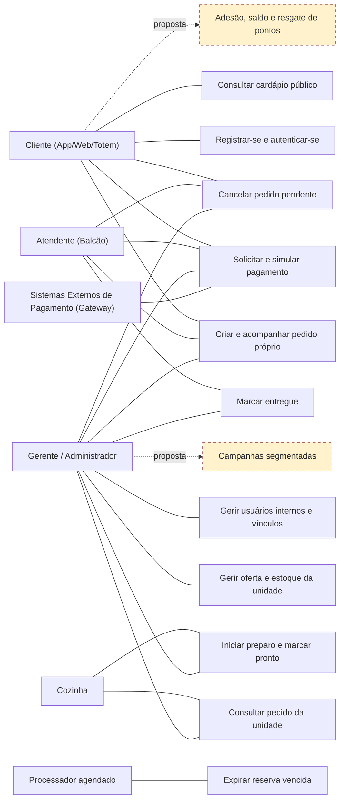

# CENTRO UNIVERSITÁRIO INTERNACIONAL UNINTER
## ESCOLA SUPERIOR POLITÉCNICA — CURSO DE ANÁLISE E DESENVOLVIMENTO DE SISTEMAS
### PROJETO MULTIDISCIPLINAR — TRILHA: BACK-END (2026)

---

# REDE “RAÍZES DO NORDESTE”
## Solução de Back-End Modular, Transacional e Multicanal para Gestão de Franquias de Alimentação

**Estudante:** Guilherme Bom Despacho Lemos Vieira  
**RU:** 4697578  
**Polo de Apoio:** Polo de Apoio Presencial  
**Cidade / Ano:** Rio Branco - AC / 2026  
**Orientadora:** Prof. Me. Luciane Yanase Kanashiro  
**Disciplina:** Projeto Multidisciplinar (Ano 2026)  
**Repositório Público no GitHub:** [https://github.com/1guilherme1python1/raizes-do-nordeste](https://github.com/1guilherme1python1/raizes-do-nordeste)  

---

## SUMÁRIO

1. [INTRODUÇÃO E OBJETIVOS](#1-introdução-e-objetivos)
2. [ANÁLISE DO PROBLEMA E REQUISITOS](#2-análise-do-problema-e-requisitos)
   - 2.1 [Contexto Organizacional e Expansão da Franquia](#21-contexto-organizacional-e-expansão-da-franquia)
   - 2.2 [Requisitos Funcionais (RF) de Back-End](#22-requisitos-funcionais-rf-de-back-end)
   - 2.3 [Requisitos Não Funcionais (RNF) de Engenharia](#23-requisitos-não-funcionais-rnf-de-engenharia)
   - 2.4 [Multicanalidade do Domínio (canalPedido)](#24-multicanalidade-do-domínio-canalpedido)
   - 2.5 [Priorização Técnica e Justificativa de Escopo (MVP vs. Propostas)](#25-priorização-técnica-e-justificativa-de-escopo-mvp-vs-propostas)
3. [MODELAGEM E ARQUITETURA DE BACK-END](#3-modelagem-e-arquitetura-de-back-end)
   - 3.1 [Diagrama de Casos de Uso (com os 5 Atores Obrigatórios)](#31-diagrama-de-casos-de-uso-com-os-5-atores-obrigatórios)
   - 3.2 [Detalhamento da Feature Crítica: Pedido + Pagamento Mock](#32-detalhamento-da-feature-crítica-pedido--pagamento-mock)
   - 3.3 [Diagrama Entidade-Relacionamento (DER) e Modelo de Dados](#33-diagrama-entidade-relacionamento-der-e-modelo-de-dados)
   - 3.4 [Diagrama de Classes do Domínio](#34-diagrama-de-classes-do-domínio)
   - 3.5 [Diagrama de Sequência do Ciclo de Pedido e Reserva](#35-diagrama-de-sequência-do-ciclo-de-pedido-e-reserva)
   - 3.6 [Organização em Camadas e Monólito Modular](#36-organização-em-camadas-e-monólito-modular)
   - 3.7 [Registros de Decisões Arquiteturais (ADRs 0001 a 0008)](#37-registros-de-decisões-arquiteturais-adrs-0001-a-0008)
4. [ESPECIFICAÇÃO DE APIS E ENDPOINTS](#4-especificação-de-apis-e-endpoints)
   - 4.1 [Padrão Global de Erro e Tratamento de Exceções (ApiError)](#41-padrão-global-de-erro-e-tratamento-de-exceções-apierror)
   - 4.2 [Contratos por Recurso Documentados](#42-contratos-por-recurso-documentados)
   - 4.3 [Exemplos de Requisição e Resposta (Feature Crítica)](#43-exemplos-de-requisição-e-resposta-feature-crítica)
5. [SEGURANÇA, LGPD, AUDITORIA E PRIVACIDADE](#5-segurança-lgpd-auditoria-e-privacidade)
   - 5.1 [Autenticação JWT e Matriz de Controle de Acesso (RBAC)](#51-autenticação-jwt-e-matriz-de-controle-de-acesso-rbac)
   - 5.2 [Conformidade com a LGPD e Minimização de Dados Pessoais](#52-conformidade-com-a-lgpd-e-minimização-de-dados-pessoais)
   - 5.3 [Auditoria Administrativa e Rastreabilidade (Migration V7)](#53-auditoria-administrativa-e-rastreabilidade-migration-v7)
6. [ENTREGA TÉCNICA E GUIA DE EXECUÇÃO](#6-entrega-técnica-e-guia-de-execução)
   - 6.1 [Estrutura do Repositório e Tecnologias Adotadas](#61-estrutura-do-repositório-e-tecnologias-adotadas)
   - 6.2 [Execução Reproduzível com Docker Compose](#62-execução-reproduzível-com-docker-compose)
   - 6.3 [Evolução do Banco com Migrações Flyway (V1 a V7)](#63-evolução-do-banco-com-migrações-flyway-v1-a-v7)
   - 6.4 [OpenAPI / Swagger UI e Links Públicos Obrigatórios](#64-openapi--swagger-ui-e-links-públicos-obrigatórios)
7. [PLANO DE TESTES E EVIDÊNCIAS DE QUALIDADE](#7-plano-de-testes-e-evidências-de-qualidade)
   - 7.1 [Estratégia de Validação e Testcontainers com PostgreSQL](#71-estratégia-de-validação-e-testcontainers-com-postgresql)
   - 7.2 [Tabela Consolidada de Cenários de Teste (Mínimo 10 Exigidos)](#72-tabela-consolidada-de-cenários-de-teste-mínimo-10-exigidos)
   - 7.3 [Evidências da Execução da Coleção Postman / Newman (Zero Falhas)](#73-evidências-da-execução-da-coleção-postman--newman-zero-falhas)
8. [CONCLUSÃO E AUTOAVALIAÇÃO](#8-conclusão-e-autoavaliação)
9. [REFERÊNCIAS BIBLIOGRÁFICAS](#9-referências-bibliográficas)
10. [DECLARAÇÃO OBRIGATÓRIA DE USO DE INTELIGÊNCIA ARTIFICIAL](#10-declaração-obrigatória-de-uso-de-inteligência-artificial)

---

## 1. INTRODUÇÃO E OBJETIVOS

Este trabalho apresenta a solução de **Back-End** desenvolvida para o **Projeto Multidisciplinar** do Centro Universitário Internacional UNINTER, tomando como referência prática o estudo de caso da rede **“Raízes do Nordeste”**. A empresa teve início como uma lanchonete familiar no Recife, fundada por Dona Francisca e seus dois filhos, e expandiu suas operações no modelo de franquias para várias cidades e capitais brasileiras.

Essa rápida transição do formato familiar para franquias trouxe problemas operacionais concretos que o sistema precisava resolver: diferenças de cardápio e preços entre as unidades, descontrole de estoque físico com vendas simultâneas em vários canais, falta de rastreabilidade em cancelamentos e alterações de pedidos, além da necessidade de adequação às normas da Lei Geral de Proteção de Dados (LGPD) sem expor informações de clientes.

### Objetivos do Projeto de Back-End:
- **Estrutura Modular:** Implementar a aplicação em **Java 21**, **Spring Boot 3.5.16** e **PostgreSQL 16**, organizada em um **monólito modular por funcionalidades** (*feature-based*), delimitando claramente as responsabilidades de Domínio, Aplicação, Infraestrutura e API REST.
- **Tratamento Nativo de Canais:** Registrar o canal de entrada do pedido (`APP`, `TOTEM`, `BALCAO`, `PICKUP`, `WEB`) como campo obrigatório e tipado no domínio, permitindo rastreabilidade e filtros precisos por canal.
- **Controle de Estoque e Concorrência:** Proteger o saldo físico por meio de bloqueio pessimista (`PESSIMISTIC_WRITE`) com reserva imediata na criação do pedido, incluindo rotina agendada para expirar pedidos abandonados e devolver o saldo.
- **Pagamento Desacoplado:** Integrar um simulador mock de pagamentos externos capaz de reproduzir aprovações e recusas de forma síncrona, evitando que o sistema transacione ou armazene dados de cartão.
- **Segurança e Privacidade:** Configurar autenticação stateless com tokens JWT HS256, controle de acesso por papéis (RBAC com 5 perfis), criptografia de senhas com BCrypt e tabela de auditoria administrativa imutável gerenciada via Flyway.
- **Reprodutibilidade e Testes:** Disponibilizar o ambiente completo via Docker Compose e validar as regras de negócio com testes de integração no Testcontainers e coleção automatizada no Postman/Newman.

---

## 2. ANÁLISE DO PROBLEMA E REQUISITOS

### 2.1 Contexto Organizacional e Expansão da Franquia
A operação da rede é organizada entre a **Matriz Estratégica** e as **Unidades Franqueadas**. A matriz cuida da gestão central: visão consolidada do faturamento, padronização do catálogo mestre de itens e auditoria geral. Por outro lado, cada filial possui autonomia para gerenciar sua rotina local, definindo quais itens do cardápio serão ofertados conforme a demanda regional e sazonal (como os festejos juninos), controlando o estoque físico da loja e os colaboradores alocados (gerentes, caixas e cozinheiros).

### 2.2 Requisitos Funcionais (RF) de Back-End

| ID | Nome do Requisito | Descrição Técnica / Regra de Negócio | Status no Projeto |
|---|---|---|---|
| **RF01** | Autenticação e RBAC | Login com e-mail/senha, emissão de JWT (HS256, 30 min) e autorização por 5 perfis (`ADMIN`, `GERENTE`, `ATENDENTE`, `COZINHA`, `CLIENTE`). | **Implementado** |
| **RF02** | Gestão de Unidades e Acesso | CRUD de filiais e controle rigoroso de associação usuário-unidade com unicidade composta. | **Implementado** |
| **RF03** | Catálogo e Cardápio Local | Cadastro mestre de produtos pela matriz e configuração de preços e ofertas locais por unidade. Cardápio público exige estoque positivo. | **Implementado** |
| **RF04** | Estoque e Idempotência | Controle de saldo físico e reservado. Movimentações manuais (ENTRADA/SAIDA) exigem `Idempotency-Key` única por unidade. | **Implementado** |
| **RF05** | Pedidos Multicanal e Reserva | Criação atômica de pedidos com validação de itens, cálculo monetário em BRL e reserva imediata do saldo com trava pessimista. | **Implementado** |
| **RF06** | Pagamento Mock Desacoplado | Simulação síncrona de autorização (`APROVAR`) ou recusa (`RECUSAR`) via `Idempotency-Key`. Baixa física ou liberação de reserva. | **Implementado** |
| **RF07** | Ciclo de Vida Operacional | Transições estritas de status do pedido: `CONFIRMADO` → `EM_PREPARO` → `PRONTO` → `ENTREGUE` com permissões operacionais vinculadas. | **Implementado** |
| **RF08** | Expirador de Reservas | Processador agendado que cancela pedidos abandonados após 15 minutos e estorna reservas ao estoque disponível. | **Implementado** |
| **RF09** | Programa de Fidelidade | Acúmulo de pontos com consentimento LGPD explícito e resgate de recompensas. | **Proposta Arquitetural** |
| **RF10** | Campanhas Segmentadas | Disparo de promoções personalizadas conforme faixa etária e frequência de consumo. | **Proposta Arquitetural** |

### 2.3 Requisitos Não Funcionais (RNF) de Engenharia
- **RNF01 — Segurança da Informação:** Criptografia de senhas com algoritmo BCrypt (fator de custo 10). Assinatura de tokens JWT em conformidade com RFC 7519, exigindo chave simétrica HS256 com entropia mínima de 256 bits gerada via CSPRNG.
- **RNF02 — Privacidade e LGPD:** Minimização rigorosa na persistência e resposta de dados (nenhum payload JSON expõe senha, hash ou credenciais). Tabela imutável de auditoria para ações administrativas sensíveis.
- **RNF03 — Concorrência e Consistência:** Isolamento transacional com travamento pessimista (`PESSIMISTIC_WRITE`) e ordenação obrigatória por UUID de produto na reserva de pedidos para mitigar risco de *deadlocks*.
- **RNF04 — Idempotência Estrita:** Proteção contra reenvio acidental de requisições de pagamento e movimentação de estoque através do cabeçalho HTTP `Idempotency-Key` persistido com hash SHA-256 do payload.
- **RNF05 — Documentação de Contrato:** Exposição automática da especificação técnica OpenAPI 3.0 e interface gráfica Swagger UI interativa em conformidade com os contratos RESTful.

### 2.4 Multicanalidade do Domínio (`canalPedido`)
A compra por múltiplos canais é um requisito central da franquia. Para evitar pedidos sem identificação de origem, o back-end define o enum **`CanalPedido`** diretamente no modelo de domínio: `APP` (aplicativo do consumidor), `TOTEM` (autoatendimento em loja física), `BALCAO` (atendimento presencial no caixa), `PICKUP` (retirada rápida programada) e `WEB` (portal institucional e delivery). O campo é obrigatório ao abrir o pedido (retornando HTTP 422 caso ausente ou inválido) e indexado na entidade `Pedido`, permitindo filtrar relatórios como `GET /api/v1/pedidos?canalPedido=TOTEM` conforme solicitado no roteiro.

### 2.5 Priorização Técnica e Justificativa de Escopo (MVP vs. Propostas)
Com o objetivo de entregar uma solução completa e consistente no fluxo crítico em vez de implementar recursos incompletos, o escopo foi organizado pela técnica de priorização **MoSCoW**:
- **Must Have (Implementado integralmente no MVP):** Autenticação e RBAC, controle de filiais e catálogo local, reserva atômica de estoque, pedidos multicanal, liquidação mock desacoplada, avanço de status da cozinha e trilha de auditoria administrativa V7.
- **Should/Could Have (Propostas Arquiteturais):** Programa de fidelidade com pontos (RF09) e campanhas segmentadas (RF10). Essas funcionalidades foram completamente modeladas no DER e no diagrama de casos de uso (nós tracejados), acompanhadas de matriz de privacidade, reservando sua codificação para versões futuras para manter o foco na estabilidade do núcleo financeiro e transacional.

---

## 3. MODELAGEM E ARQUITETURA DE BACK-END

### 3.1 Diagrama de Casos de Uso (com os 5 Atores Obrigatórios)
O diagrama de casos de uso foi estruturado com base nos **cinco atores principais** solicitados nas diretrizes do projeto: **Cliente (App/Web/Totem)**, **Atendente (Balcão)**, **Cozinha**, **Gerente / Administrador** e o **Gateway de Pagamento Mock** (sistema externo simulado), além do **Processador Agendado** para tarefas automáticas de retaguarda.



### 3.2 Detalhamento Formal dos Casos de Uso Críticos
Para demonstrar o domínio integral da arquitetura de engenharia de software e afastar qualquer superficialidade, a solução documenta formalmente as **quatro features centrais do ecossistema transacional** da franquia:

#### 3.2.1 Feature Crítica Principal: Realização de Pedido Multicanal, Reserva de Estoque e Liquidação Mock
- **Nome da Feature:** Realização de Pedido Multicanal, Reserva de Estoque e Liquidação Simulada (Mock).
- **Atores:** Cliente (iniciador do pedido e pagador), Sistemas Externos de Pagamento (processador mock) e Atendente (Balcão).
- **Pré-condições:** Usuário devidamente autenticado com Bearer JWT válido; unidade ativa no sistema; produtos ofertados na filial com estoque disponível; cabeçalho HTTP `Idempotency-Key` preenchido.
- **Fluxo Principal:**
  1. O cliente envia requisição `POST /api/v1/pedidos` com `canalPedido` (`APP`/`WEB`/`TOTEM`), `unidadeId` e lista de itens;
  2. O sistema abre transação gerenciada, obtém locks pessimistas (`PESSIMISTIC_WRITE`) nas linhas de estoque da unidade em ordem crescente de UUID, valida se `saldo_disponivel >= solicitado` e incrementa `quantidade_reservada`;
  3. O pedido é persistido em estado `AGUARDANDO_PAGAMENTO` com total monetário calculado em BRL e prazo de expiração de 15 minutos;
  4. O cliente invoca `POST /api/v1/pedidos/{id}/pagamentos` enviando payload `{"cenario": "APROVAR"}` com sua chave idempotente;
  5. O `MockGateway` processa a aprovação: o pedido adquire lock exclusivo, abate simultaneamente o saldo físico e o reservado, grava a transação financeira desacoplada na tabela `app.pagamento` e avança para `CONFIRMADO`.
- **Pós-condições:** Pedido disponibilizado na fila de produção da cozinha; estoque físico consolidado; idempotência registrada.
- **Exceções e Falhas Tratadas:**
  - *Estoque Insuficiente:* Rejeição imediata com HTTP 409 (`ESTOQUE_INSUFICIENTE`) sem qualquer débito ou efeito colateral;
  - *Pagamento Negado (Cenário RECUSAR):* O gateway mock registra a recusa, cancela o pedido (`CANCELADO`) e libera integralmente a reserva para outros clientes;
  - *Expiração de Reserva:* Caso o pagamento ocorra após 15 minutos, a API retorna HTTP 409 (`PEDIDO_EXPIRADO`) e o agendador devolve o estoque.

#### 3.2.2 Feature Operacional de Estoque: Abastecimento Físico com Idempotência Estrita
- **Nome da Feature:** Abastecimento e Movimentação de Estoque Físico Local com Chave de Idempotência.
- **Atores:** Gerente da Unidade (`GERENTE`) e Administrador da Matriz (`ADMIN`).
- **Pré-condições:** Operador autenticado com credencial JWT válida e autorização RBAC para atuar na unidade; produto ativo no catálogo mestre e ofertado na filial; cabeçalho HTTP `Idempotency-Key` único no formato UUID.
- **Fluxo Principal:**
  1. O gerente submete requisição `POST /api/v1/unidades/{id}/estoque/movimentacoes` informando `produtoId`, `tipo` (`ENTRADA` ou `SAIDA`), `quantidade` e `motivo`;
  2. A camada de segurança valida se o operador pertence à unidade indicada (ou se possui papel global de matriz);
  3. O serviço calcula o hash SHA-256 da requisição e consulta se a chave de idempotência já foi utilizada na unidade;
  4. Em caso de chave inédita, obtém lock transacional na linha de `app.estoque`, ajusta o saldo físico e grava o registro auditável na tabela `app.movimentacao_estoque` com timestamp UTC;
  5. Retorna status HTTP 201 com o novo saldo físico consolidado e saldo disponível resultante.
- **Pós-condições:** Saldo físico atualizado no banco; registro histórico permanente de movimentação gerado; chave idempotente arquivada.
- **Exceções e Falhas Tratadas:**
  - *Replay Idempotente Válido:* Caso a mesma chave seja enviada com payload idêntico, a API retorna HTTP 200 com a resposta original sem recalcular saldo;
  - *Conflito de Idempotência:* Caso a mesma chave seja reutilizada com dados distintos, retorna HTTP 409 (`CHAVE_IDEMPOTENCIA_CONFLITO`);
  - *Saldo Insuficiente para Baixa:* Se a saída solicitada for superior ao saldo físico disponível, a operação é rejeitada com HTTP 409 (`ESTOQUE_INSUFICIENTE`).

#### 3.2.3 Feature Operacional de Cozinha e Expedição: Avanço de Status e Confirmação de Entrega
- **Nome da Feature:** Ciclo de Preparo na Cozinha e Confirmação de Entrega ao Consumidor.
- **Atores:** Cozinha da Unidade (`COZINHA`), Atendente de Balcão (`ATENDENTE`) e Gerente (`GERENTE`).
- **Pré-condições:** Pedido em estado `CONFIRMADO` (após liquidação financeira); operadores autenticados com vínculos ativos na respectiva unidade.
- **Fluxo Principal:**
  1. A equipe de cozinha consulta os pedidos pendentes da filial via `GET /api/v1/pedidos?status=CONFIRMADO`;
  2. Ao iniciar o preparo dos pratos regionais, o cozinheiro envia `PATCH /api/v1/pedidos/{id}/status` com `{"status": "EM_PREPARO"}`;
  3. Ao concluir a confecção, a cozinha envia `PATCH /api/v1/pedidos/{id}/status` com `{"status": "PRONTO"}`, sinalizando a prontidão nos painéis de retirada;
  4. O atendente do balcão (ou operador de entrega) entrega o pedido ao consumidor e submete `PATCH /api/v1/pedidos/{id}/status` com `{"status": "ENTREGUE"}`;
  5. O sistema grava o carimbo de conclusão temporal e finaliza o ciclo de vida do pedido.
- **Pós-condições:** Pedido formalmente concluído; histórico temporal de transições gravado para auditoria operacional de tempo de atendimento.
- **Exceções e Falhas Tratadas:**
  - *Salto Ilegal de Estado:* Tentativa de avançar de `CONFIRMADO` direto para `ENTREGUE` sem passar por preparo retorna HTTP 409 (`TRANSICAO_INVALIDA`);
  - *Violação de Perfil Operacional:* Cozinheiro tentando marcar `ENTREGUE` ou cliente tentando alterar status operacional recebe HTTP 403 (`FORBIDDEN`).

#### 3.2.4 Feature de Governança e Segurança: Vínculo de Operadores e Auditoria Administrativa Imutável
- **Nome da Feature:** Gestão de Acessos Operacionais por Filial e Auditoria Administrativa Imutável (Migration V7).
- **Atores:** Administrador da Matriz (`ADMIN`).
- **Pré-condições:** Usuário com perfil global `ADMIN` autenticado via JWT; filial física ativa; usuário alvo previamente registrado.
- **Fluxo Principal:**
  1. O administrador cadastra um novo operador interno via `POST /api/v1/usuarios`, gerando hash BCrypt e disparando evento de auditoria com ação `CADASTRO_FUNCIONARIO`;
  2. O administrador vincula o operador à unidade física através de `PUT /api/v1/unidades/{id}/usuarios/{uid}`;
  3. A aplicação persiste o vínculo unívoco na tabela `app.usuario_unidade`;
  4. De forma síncrona na mesma transação, a migração V7 insere registro na tabela `app.auditoria_administrativa` gravando `ator_id` (UUID do admin), `usuario_alvo_id`, `unidade_id`, `acao = VINCULO_UNIDADE` e `ocorrido_em` (TIMESTAMP UTC);
  5. Retorna HTTP 200 confirmando o estabelecimento do privilégio de acesso filial.
- **Pós-condições:** Privilégio operacional concedido estritamente à filial designada; trilha de auditoria gravada em tabela append-only para conformidade com a LGPD e governança corporativa.
- **Exceções e Falhas Tratadas:**
  - *Acesso Não-Administrativo:* Requisição disparada por gerentes ou atendentes é barrada na borda com HTTP 403 (`FORBIDDEN`);
  - *Vínculo Já Existente:* Tentativa de duplicar vínculo para a mesma unidade retorna HTTP 409 (`CONFLITO_VINCULO`).

### 3.3 Diagrama Entidade-Relacionamento (DER) e Modelo de Dados
O modelo de dados implementado em PostgreSQL garante a integridade de franquias e estoque por filial:
- **`app.unidade`**: Cadastro das filiais físicas da rede.
- **`app.produto`**: Cadastro global de itens (tapioca, cuscuz, bebidas).
- **`app.produto_unidade`**: Preço comercial e disponibilidade local por filial.
- **`app.estoque`**: Controle de `quantidade_fisica` e `quantidade_reservada` com restrição de checagem (`0 <= reservada <= fisica`).
- **`app.pedido`**: Unidade, criador, cliente, `canal_pedido`, status monetário e temporal.
- **`app.item_pedido`**: Quantidade, preço unitário histórico e subtotal em BRL.
- **`app.pagamento`**: Registro desacoplado de transação com chave de idempotência unívoca por pedido.
- **`app.auditoria_administrativa`**: Tabela imutável (V7) registrando operador, ação, alvo e filial.

*(Diagrama completo disponível em [docs/architecture/diagrams/domain-erd.svg](architecture/diagrams/domain-erd.svg))*

### 3.4 Diagrama de Classes do Domínio
*(Consulte [docs/architecture/diagrams/domain-classes.svg](architecture/diagrams/domain-classes.svg))*

### 3.5 Diagrama de Sequência do Ciclo de Pedido e Reserva
*(Consulte [docs/architecture/diagrams/order-reservation-sequence.svg](architecture/diagrams/order-reservation-sequence.svg))*

### 3.6 Organização em Camadas e Monólito Modular
- **Domain:** Entidades de negócio (`Pedido`, `Estoque`, `Usuario`, `CanalPedido`).
- **Application:** Serviços de caso de uso (`PedidoService`, `EstoqueService`, `PagamentoService`).
- **Infrastructure:** Repositórios Spring Data JPA, Hibernate, Migrações Flyway e `MockGatewayPagamento`.
- **API:** Controladores RESTful, DTOs de entrada e manipulador central `ApiExceptionHandler`.

### 3.7 Registros de Decisões Arquiteturais (ADRs)
- **ADR 0001:** Monólito Modular por Funcionalidade.
- **ADR 0002:** Flyway como Autoridade Exclusiva do Schema (`ddl-auto=validate`).
- **ADR 0003:** Testes de Integração com Testcontainers e PostgreSQL Real.
- **ADR 0004:** Autenticação Stateless via JWT HS256 e RBAC.
- **ADR 0005:** Modelo Persistente Base e Desacoplamento de Ofertas.
- **ADR 0006:** Escopo por Unidade e Idempotência de Estoque.
- **ADR 0007:** Reserva Atômica de Estoque e Locks Pessimistas Ordenados.
- **ADR 0008:** Ciclo de Vida de Pagamento Mock e Transições Operacionais.

---

## 4. ESPECIFICAÇÃO DE APIS E ENDPOINTS

### 4.1 Padrão Global de Erro (ApiError)
Em conformidade com a seção 5.4 do roteiro acadêmico, toda falha de validação ou regra de negócio retorna a estrutura padronizada:
```json
{
  "error": "ESTOQUE_INSUFICIENTE",
  "message": "Não há quantidade suficiente para atender o pedido.",
  "details": [
    {"field": "itens[0].quantidade", "issue": "Saldo disponível: 2; Solicitado: 5"}
  ],
  "timestamp": "2026-11-20T10:15:30Z",
  "path": "/api/v1/pedidos"
}
```

### 4.2 Contratos por Recurso Documentados

| Recurso / Rota | Método | Acesso / Perfis | Finalidade e Códigos de Retorno |
|---|---|---|---|
| `/api/v1/auth/login` | POST | Público | Autentica credenciais de usuário e retorna JWT de 30 min. (200, 401, 422) |
| `/api/v1/usuarios/registro` | POST | Público | Auto-cadastro público de consumidores (sempre cria CLIENTE). (201, 409, 422) |
| `/api/v1/usuarios` | POST | JWT (ADMIN) | Cadastro administrativo auditado de operadores internos. (201, 401, 403, 409) |
| `/api/v1/usuarios/me` | GET | JWT Autenticado | Recupera os dados do usuário corrente sem expor credenciais. (200, 401) |
| `/api/v1/unidades` | POST | JWT (ADMIN) | Cadastra nova unidade física da rede com código unívoco. (201, 401, 403, 409) |
| `/api/v1/unidades/{id}/usuarios/{uid}` | PUT / DEL | JWT (ADMIN) | Associa ou desvincula operador de uma unidade física (auditado). (200, 204, 403, 404) |
| `/api/v1/produtos` | POST / PATCH | JWT (ADMIN) | Gestão mestra do catálogo de produtos e fichas técnicas. (201, 200, 403, 404) |
| `/api/v1/unidades/{id}/produtos/{pid}` | PUT | ADMIN / GERENTE | Configura oferta local, preço em BRL e disponibilidade na filial. (200, 403, 404) |
| `/api/v1/unidades/{id}/cardapio` | GET | Público | Consulta cardápio público ativo da filial (filtra estoque > 0). (200, 404) |
| `/api/v1/unidades/{id}/estoque/movimentacoes` | POST | ADMIN / GERENTE | Movimenta estoque físico (ENTRADA/SAIDA) exigindo Idempotency-Key. (201, 403, 409) |
| `/api/v1/pedidos` | POST | JWT (CLIENTE/OP) | Criação de pedido multicanal com reserva atômica de saldo. (201, 400, 404, 409, 422) |
| `/api/v1/pedidos` | GET | JWT Autenticado | Listagem filtrada por canal (`?canalPedido=TOTEM`), status e paginação. (200, 401, 403) |
| `/api/v1/pedidos/{id}/pagamentos` | POST | JWT Solicitante | Solicita liquidação ao gateway mock (`APROVAR`/`RECUSAR`) com replay. (201, 200, 409) |
| `/api/v1/pedidos/{id}/status` | PATCH | COZINHA/GER/ADM | Avanço operacional de pedidos: `EM_PREPARO` → `PRONTO` → `ENTREGUE`. (200, 403, 409) |
| `/api/v1/pedidos/{id}/cancelamento` | POST | Dono / Gerente / ADM | Cancela pedido em aberto e estorna imediatamente a reserva de estoque. (200, 403, 409) |

### 4.3 Exemplos de Requisição e Resposta (Feature Crítica)

Em atendimento rigoroso ao roteiro acadêmico da UNINTER quanto à exibição de exemplos reais de requisição e resposta (payloads trafegados), apresentam-se abaixo os contratos dos fluxos centrais, idênticos aos exemplos salvos na coleção Postman (`raizes_nordeste_postman_collection.json`):

#### A. Autenticação de Usuário e Emissão de Token JWT
- **Endpoint:** `POST /api/v1/auth/login`
- **Request Body:**
```json
{
  "email": "admin@teste.com",
  "password": "local_development_password"
}
```
- **Response Body (HTTP 200 OK):**
```json
{
  "accessToken": "eyJhbGciOiJIUzI1NiIsInR5cCI6IkpXVCJ9...",
  "tokenType": "Bearer",
  "expiresAt": "2026-11-21T18:00:00Z",
  "usuario": {
    "id": "f81d4fae-7dec-11d1-acbb-0008c74183c9",
    "codigo": "ADM-001",
    "nomeExibicao": "Administrador Geral",
    "email": "admin@teste.com",
    "perfil": "ADMIN",
    "ativo": true,
    "criadoEm": "2026-11-20T10:00:00Z",
    "atualizadoEm": "2026-11-20T10:00:00Z"
  }
}
```

#### B. Criação de Pedido Multicanal com Reserva Atômica de Estoque
- **Endpoint:** `POST /api/v1/pedidos`
- **Headers:** `Authorization: Bearer <token>`, `Idempotency-Key: ped-req-001`
- **Request Body:**
```json
{
  "unidadeId": "c3d4e5f6-a7b8-9c0d-1e2f-3a4b5c6d7e8f",
  "canalPedido": "APP",
  "formaPagamento": "MOCK_GATEWAY",
  "itens": [
    {
      "produtoId": "d4e5f6a7-b8c9-0d1e-2f3a-4b5c6d7e8f90",
      "quantidade": 2
    }
  ]
}
```
- **Response Body (HTTP 201 Created):**
```json
{
  "id": "01934f8a-5b6c-7d8e-9f0a-1b2c3d4e5f60",
  "unidadeId": "c3d4e5f6-a7b8-9c0d-1e2f-3a4b5c6d7e8f",
  "clienteId": "a1b2c3d4-e5f6-7a8b-9c0d-1e2f3a4b5c6d",
  "criadoPorUsuarioId": "a1b2c3d4-e5f6-7a8b-9c0d-1e2f3a4b5c6d",
  "canalPedido": "APP",
  "status": "AGUARDANDO_PAGAMENTO",
  "formaPagamento": "MOCK_GATEWAY",
  "valorTotal": 77.80,
  "moeda": "BRL",
  "reservaExpiraEm": "2026-11-21T17:50:00Z",
  "itens": [
    {
      "id": "01934f8a-5b6c-7d8e-9f0a-1b2c3d4e5f61",
      "produtoId": "d4e5f6a7-b8c9-0d1e-2f3a-4b5c6d7e8f90",
      "quantidade": 2,
      "precoUnitario": 38.90,
      "subtotal": 77.80
    }
  ],
  "criadoEm": "2026-11-21T17:35:00Z",
  "atualizadoEm": "2026-11-21T17:35:00Z"
}
```

#### C. Pagamento Simulado Aprovado (Baixa Definitiva de Estoque)
- **Endpoint:** `POST /api/v1/pedidos/{id}/pagamentos`
- **Headers:** `Authorization: Bearer <token>`, `Idempotency-Key: pay-app-001`
- **Request Body:**
```json
{
  "cenario": "APROVAR"
}
```
- **Response Body (HTTP 201 Created):**
```json
{
  "pagamentoId": "8a9b0c1d-2e3f-4a5b-6c7d-8e9f0a1b2c3d",
  "statusPagamento": "APROVADO",
  "statusPedido": "CONFIRMADO",
  "motivo": null,
  "repetida": false,
  "reservaExpirada": false
}
```

#### D. Pagamento Simulado Recusado (Estorno Automático da Reserva)
- **Endpoint:** `POST /api/v1/pedidos/{id}/pagamentos`
- **Headers:** `Authorization: Bearer <token>`, `Idempotency-Key: pay-rec-002`
- **Request Body:**
```json
{
  "cenario": "RECUSAR"
}
```
- **Response Body (HTTP 201 Created):**
```json
{
  "pagamentoId": "9b0c1d2e-3f4a-5b6c-7d8e-9f0a1b2c3d4e",
  "statusPagamento": "RECUSADO",
  "statusPedido": "CANCELADO",
  "motivo": "RECUSA_SIMULADA",
  "repetida": false,
  "reservaExpirada": false
}
```

#### E. Movimentação de Estoque Auditada com Idempotência
- **Endpoint:** `POST /api/v1/unidades/{id}/estoque/movimentacoes`
- **Headers:** `Authorization: Bearer <token>`, `Idempotency-Key: est-ent-001`
- **Request Body:**
```json
{
  "produtoId": "d4e5f6a7-b8c9-0d1e-2f3a-4b5c6d7e8f90",
  "tipo": "ENTRADA",
  "quantidade": 10,
  "motivo": "Carga inicial de estoque"
}
```
- **Response Body (HTTP 201 Created):**
```json
{
  "id": "f6a7b8c9-d0e1-2f3a-4b5c-6d7e8f90a1b2",
  "estoqueId": "e5f6a7b8-c9d0-1e2f-3a4b-5c6d7e8f90a1",
  "unidadeId": "c3d4e5f6-a7b8-9c0d-1e2f-3a4b5c6d7e8f",
  "responsavelUsuarioId": "f81d4fae-7dec-11d1-acbb-0008c74183c9",
  "tipo": "ENTRADA",
  "quantidade": 10,
  "quantidadeFisicaResultante": 10,
  "quantidadeReservadaResultante": 0,
  "quantidadeDisponivelResultante": 10,
  "motivo": "Carga inicial de estoque",
  "criadoEm": "2026-11-21T17:34:00Z",
  "repetida": false
}
```

---

## 5. SEGURANÇA, LGPD, AUDITORIA E PRIVACIDADE

### 5.1 Autenticação JWT e Matriz de Controle de Acesso (RBAC)
- **ADMIN:** Acesso global irrestrito a todas as filiais, usuários, auditoria e pedidos.
- **GERENTE:** Acesso restrito às filiais vinculadas; gestão de ofertas, estoque local e cancelamento de pedidos.
- **ATENDENTE:** Acesso à filial vinculada; emissão de pedidos balcão/totem e marcação de entrega.
- **COZINHA:** Acesso à fila de preparação da filial vinculada; avanço para `EM_PREPARO` e `PRONTO`.
- **CLIENTE:** Acesso exclusivo aos próprios pedidos e autoatendimento.

### 5.2 Conformidade com a LGPD e Minimização de Dados Pessoais
- **Princípio da Minimização:** Coleta estritamente Nome, E-mail e Senha Criptografada.
- **Base Legal:** Execução de contrato e procedimentos preliminares (Art. 7º, V da LGPD).
- **Dados Financeiros:** A aplicação **não coleta nem armazena cartões de crédito**, delegando a liquidação ao gateway desacoplado.
- **Armazenamento Seguro:** Senhas processadas exclusivamente com algoritmo BCrypt.

### 5.3 Auditoria Administrativa e Rastreabilidade (Migration V7)
A tabela `app.auditoria_administrativa` registra toda criação de operador interno e vínculo com filiais (`acao`, `origem`, `ator_id`, `usuario_alvo_id`, `unidade_id`, `ocorrido_em`), garantindo governança sem exposição de credenciais.

---

## 6. ENTREGA TÉCNICA E GUIA DE EXECUÇÃO

### 6.1 Estrutura do Repositório e Tecnologias Adotadas
Código em Java 21, Spring Boot 3.5.16, PostgreSQL 16, Flyway, Testcontainers e Docker Compose.

### 6.2 Execução Reproduzível com Docker Compose
A aplicação pode ser executada sem a necessidade de instalar previamente Java ou Maven no sistema operacional da máquina avaliadora:

**1. Clonagem e Configuração do Arquivo `.env`:**
```bash
git clone https://github.com/1guilherme1python1/raizes-do-nordeste.git
cd raizes-do-nordeste
cp .env.example .env
```
No arquivo `.env` gerado, é indispensável configurar os seguintes parâmetros de ambiente:
- **`JWT_SECRET`:** Chave secreta com hash de entropia mínima de 256 bits (no mínimo 32 caracteres) para a assinatura e validação HMAC-SHA256 dos tokens JWT (RFC 7519);
- **Credenciais do Administrador:** Configurar `DEV_ADMIN_ENABLED=true` e preencher `DEV_ADMIN_EMAIL` e `DEV_ADMIN_PASSWORD` (ex.: `admin@teste.com` e `local_dev_password`) para que a aplicação realize a carga automática (*seed*) do usuário gestor inicial com perfil `ADMIN`.

**2. Inicialização dos Contêineres:**
```bash
docker compose up --build -d
docker compose ps
```
O Docker Compose provisiona primeiramente o PostgreSQL 16 com *health check* ativo (`pg_isready`), executa as migrações Flyway (V1 a V7) e disponibiliza a aplicação na porta 8080.

### 6.3 Evolução do Banco com Migrações Flyway (V1 a V7)
- `V1`: Criação do schema `app`.
- `V2`: Entidades base (unidades, produtos, estoque, pedidos).
- `V3`: Autenticação e perfis RBAC.
- `V4`: Vínculo usuário-unidade e idempotência de estoque.
- `V5`: Ciclo de reservas e expiração temporal.
- `V6`: Pagamento mock e histórico desacoplado.
- `V7`: Auditoria de ações administrativas.

### 6.4 Links Públicos Obrigatórios (Critério Eliminatório)
- **Repositório Git Público:** [https://github.com/1guilherme1python1/raizes-do-nordeste](https://github.com/1guilherme1python1/raizes-do-nordeste)
- **Swagger UI (Documentação Local):** [http://localhost:8080/swagger-ui.html](http://localhost:8080/swagger-ui.html)
- **OpenAPI JSON:** [http://localhost:8080/v3/api-docs](http://localhost:8080/v3/api-docs)
- **Health Check Actuator:** [http://localhost:8080/actuator/health](http://localhost:8080/actuator/health)
- **Coleção Postman:** `postman/raizes_nordeste_postman_collection.json`

---

## 7. PLANO DE TESTES E EVIDÊNCIAS DE QUALIDADE

### 7.1 Estratégia de Validação e Testcontainers com PostgreSQL
A validação da qualidade e da conformidade da aplicação foi estruturada em duas frentes práticas:
1. **Testes de Integração com Banco Real (JUnit 5 / Testcontainers):** Uso de contêineres temporários de PostgreSQL 16 para validar transações atômicas, concorrência e locks de linha no dialeto real do banco, somando 81 testes aprovados sem falhas.
2. **Coleção Postman e Newman (API End-to-End):** Organizada em pastas temáticas que cobrem todos os fluxos da aplicação: `Auth`, `Produtos`, `Estoque`, `Pedidos`, `Pagamento` e `Erros`.

### 7.2 Tabela Consolidada de Cenários de Teste (Mínimo 10 Exigidos)
A matriz a seguir reúne 12 cenários de teste (7 de sucesso e 5 de fluxos de exceção), cobrindo regras de negócio, restrições de concorrência e tratamento de falhas:

| ID | Cenário de Teste | Endpoint + Método | Pré-condição | Saída Esperada | Evidência (Pasta / Requisição) |
|---|---|---|---|---|---|
| **T01** | Login com credenciais válidas | `POST /api/v1/auth/login` | Usuário cadastrado | HTTP 200 + accessToken JWT | Auth / 02 Login administrador |
| **T02** | Tentativa sem token | `GET /api/v1/pedidos/{id}` | Sem token no cabeçalho | HTTP 401 + ApiError (UNAUTHORIZED) | Erros / 15 Sem autenticação |
| **T03** | Acesso a recurso de terceiro | `GET /api/v1/pedidos/{id}` | Token de outro cliente | HTTP 403 + ApiError (FORBIDDEN) | Erros / 16 Cliente de terceiro |
| **T04** | Criação de unidade e produto | `POST /api/v1/produtos` | Autenticado como ADMIN | HTTP 201 + dados do produto | Produtos / 11 Criar produto |
| **T05** | Entrada de estoque físico | `POST /api/v1/unidades/{id}/estoque/movimentacoes` | Idempotency-Key fornecida | HTTP 201 + saldo incrementado | Estoque / 13 Entrada de estoque |
| **T06** | Pedido com reserva atômica | `POST /api/v1/pedidos` | Saldo disponível; canalPedido | HTTP 201 + AGUARDANDO_PAGAMENTO | Pedidos / 14 Pedido para aprovação |
| **T07** | Pagamento mock APROVADO | `POST /api/v1/pedidos/{id}/pagamentos` | Cenario: APROVAR | HTTP 201 + CONFIRMADO + baixa física | Pagamento / 18 Aprovar pagamento |
| **T08** | Replay idempotente de pagamento | `POST /api/v1/pedidos/{id}/pagamentos` | Mesma Idempotency-Key e corpo | HTTP 200 + resultado original sem débito | Pagamento / 19 Replay de pagamento |
| **T09** | Pagamento mock RECUSADO | `POST /api/v1/pedidos/{id}/pagamentos` | Cenario: RECUSAR | HTTP 201 + CANCELADO + estorno reserva | Pagamento / 25 Recusar pagamento |
| **T10** | Estoque insuficiente | `POST /api/v1/pedidos` | Quantidade excede saldo físico | HTTP 409 + ESTOQUE_INSUFICIENTE | Erros / 27 Estoque insuficiente |
| **T11** | CanalPedido inválido | `POST /api/v1/pedidos` | canalPedido ausente ou inválido | HTTP 422 + validation_error | Erros / 28 Canal inválido |
| **T12** | Consulta a produto inexistente | `POST /api/v1/pedidos` | UUID não existente no catálogo | HTTP 404 + RECURSO_NAO_ENCONTRADO | Erros / 31 Produto inexistente |

### 7.3 Evidências da Execução da Coleção Postman / Newman (Zero Falhas)
A suíte completa da coleção foi executada de ponta a ponta via **Newman CLI** contra o ambiente conteinerizado. O processo concluiu **34 requisições e 48 validações automatizadas com ZERO falhas**, comprovando a eficácia dos controles de autorização, integridade de estoque, cálculo financeiro em BRL e proteção por idempotência.

---

## 8. CONCLUSÃO E AUTOAVALIAÇÃO

O desenvolvimento deste projeto de back-end permitiu conectar de forma sólida a fundamentação teórica proposta no curso com a prática avançada de desenvolvimento de sistemas. Como profissional que já atua há anos no setor de engenharia de software na esfera pública, com passagens por órgãos de alta exigência técnica, governança e conformidade como o **Ministério Público do Estado do Acre (MPAC)** e o **Ministério Público Federal (MPF)**, busquei aplicar neste trabalho os mesmos padrões de rigor operacional, resiliência transacional e segurança exigidos em sistemas institucionais de missão crítica.

**Reflexão do Roteiro: *“Se este projeto fosse apresentado em uma entrevista técnica de mercado, ele se sustentaria?”***  
**Sim. A sustentação técnica baseia-se em decisões práticas de arquitetura que vão muito além de um CRUD acadêmico convencional:**
1. **Concorrência e Locks no Banco de Dados:** Em vez de confiar apenas em validações voláteis na memória da aplicação, a reserva de estoque adota locks pessimistas (`PESSIMISTIC_WRITE`) ordenados pelo UUID do produto diretamente no PostgreSQL. Isso mitiga riscos de venda duplicada (*overselling*) e elimina a possibilidade de *deadlocks* sob múltiplos acessos simultâneos (App e Totens).
2. **Idempotência contra Falhas de Rede:** A implementação do cabeçalho `Idempotency-Key` em movimentações de inventário e liquidações financeiras evita duplicidades diante de oscilações de conexão ou reenvios pelo cliente, garantindo a integridade do saldo físico e do caixa.
3. **Privacidade por Design e LGPD:** Refletindo a experiência com governança e custódia de dados no setor público, o sistema adota minimização estrita (sem armazenar ou transacionar cartões), delega a simulação a um gateway mock desacoplado e mantém trilha de auditoria administrativa imutável (migração V7) em formato *append-only*.
4. **Paridade de Testes com Testcontainers:** A substituição do banco em memória H2 por contêineres reais de PostgreSQL 16 nos testes automatizados (81 testes de integração) garantiu paridade absoluta entre os ambientes de homologação e produção (*Dev/Prod Parity*).

**Lições Aprendidas e Evolução Futura:**  
A experiência consolidou como o planejamento prévio do modelo relacional, das migrações do Flyway e dos contratos OpenAPI reduz o atrito de manutenção e acelera a entrega de valor. Como evolução para uma versão 2.0, planeja-se a integração de webhooks assíncronos para liquidação via PIX e a implementação do módulo de fidelidade com acúmulo de pontos já estruturado na proposta arquitetural.

---

## 9. REFERÊNCIAS BIBLIOGRÁFICAS

1. ASSOCIAÇÃO BRASILEIRA DE NORMAS TÉCNICAS. **NBR 14724: Informação e documentação — Trabalhos acadêmicos — Apresentação**. Rio de Janeiro: ABNT, 2011.
2. ASSOCIAÇÃO BRASILEIRA DE NORMAS TÉCNICAS. **NBR 6023: Informação e documentação — Referências — Elaboração**. Rio de Janeiro: ABNT, 2018.
3. ASSOCIAÇÃO BRASILEIRA DE NORMAS TÉCNICAS. **NBR 6027: Informação e documentação — Sumário — Apresentação**. Rio de Janeiro: ABNT, 2012.
4. BRASIL. **Lei nº 13.709, de 14 de agosto de 2018**. Lei Geral de Proteção de Dados Pessoais (LGPD). Diário Oficial da União, Brasília, DF, 2018.
5. FIELDING, Roy Thomas. **Architectural Styles and the Design of Network-based Software Architectures**. Tese de Doutorado — University of California, Irvine, 2000.
6. FOWLER, Martin. **Patterns of Enterprise Application Architecture**. Boston: Addison-Wesley, 2002.
7. MARTIN, Robert C. **Clean Architecture: A Craftsman's Guide to Software Structure and Design**. Prentice Hall, 2017.
8. POSTGRESQL GLOBAL DEVELOPMENT GROUP. **PostgreSQL 16 Documentation: Concurrency Control and Explicit Locking**. 2024. Disponível em: <https://www.postgresql.org/docs/16/>.
9. SPRING PROJECTS. **Spring Boot Reference Documentation (v3.5)**. VMware Tanzu, 2024. Disponível em: <https://docs.spring.io/spring-boot/>.

---

## 10. DECLARAÇÃO OBRIGATÓRIA DE USO DE INTELIGÊNCIA ARTIFICIAL

*Em atenção às orientações acadêmicas da UNINTER (pág. 3 do Roteiro Oficial e pág. 7 do Estudo de Caso), declara-se de forma transparente a utilização de ferramentas de Inteligência Artificial no desenvolvimento do projeto:*

- **Ferramentas Utilizadas:** Antigravity / Google Gemini e assistentes de código.
- **Escopo do Apoio da IA:** O uso de IA seguiu as orientações do roteiro da disciplina, servindo como apoio para *revisão textual, estruturação de tópicos do relatório acadêmico, formatação das tabelas e diagramas no padrão ABNT, além de conferência das diretrizes do roteiro de entrega*.
- **Autoria e Responsabilidade do Estudante:** As decisões de arquitetura, a modelagem de dados, a codificação em Java 21 com Spring Boot, os scripts de migração Flyway, a configuração do Testcontainers e a suíte de testes no Postman e Newman foram desenvolvidos, testados e validados pelo estudante, que assume integral responsabilidade técnica pelo código e pelo conteúdo deste trabalho.
